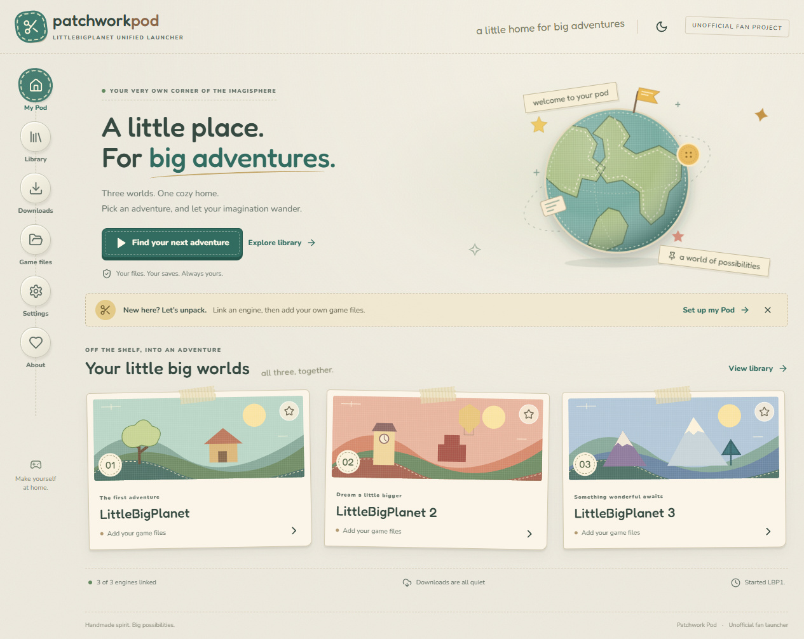
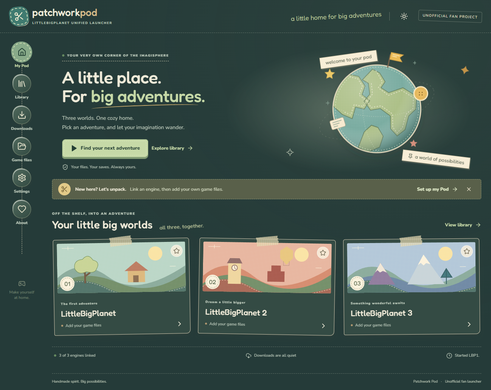

# Patchwork Pod

**LittleBigPlanet Unified Launcher** — a handmade Windows home for three adventures.

An independent fan launcher built with Rust, Tauri 2, React and TypeScript. Original stitched planets, layered paper, tactile game cards, daytime and nighttime themes. No game files or official artwork are included.

## Download

[Windows installer and portable ZIP](https://github.com/YasrAX2/LittleBigPlanet-Unified-Launcher/releases/latest). Download SHA256SUMS.txt to verify your files. See [installation and use](docs/USAGE.md), [troubleshooting](docs/TROUBLESHOOTING.md) and the [verification record](docs/TESTING.md). The app is unsigned. Game compatibility is determined by the upstream engine.





## Supported engines

| Game | Windows option | Native project |
| --- | --- | --- |
| LittleBigPlanet | RPCS3, extracted PS3 game folders | LittleBigRecomp currently targets Apple Silicon macOS; future official Windows builds can be discovered/imported |
| LittleBigPlanet 2 | RPCS3, extracted PS3 game folders | RePlanet has no verified public release endpoint; future official Windows executables can be imported |
| LittleBigPlanet 3 | LBPPC official GitHub Windows release | US CUSA00473 and Europe CUSA00063, game update 1.28 as checked 2026-11-16 |

LBPPC requirements refresh from its official README and are cached for offline use. Unexpected documentation formats produce an error rather than changing requirements silently. The engine remains the final authority on compatibility.

## Build

Windows 10/11 x64, Node.js 24+, Rust stable (MSVC), Visual Studio C++ build tools, Windows SDK and WebView2.

```powershell
npm ci
npm test
npm run build
cargo test --manifest-path src-tauri/Cargo.toml --locked
npm run tauri -- build --bundles nsis
```

Development: `npm run tauri -- dev`. The browser frontend requires the real Tauri backend. It never fabricates installed games or successful actions.

## Privacy and ownership

Game folders are referenced read-only. Engines live separately. Imported engine installations are never automatically updated or uninstalled. Managed updates retain the previous installation, preserve user-created files and customized settings, and support rollback. Uninstall moves a managed engine into a retained backup instead of deleting saves. Configuration backup contains local paths; keep it private.

No account, advertising or telemetry. Automatic update discovery contacts GitHub. Diagnostics are generated locally and omit paths, usernames, logs, artwork and credentials. LBPPC's own online account data stays in its own launcher.

## Project notes

See [upstream research](docs/UPSTREAM.md), [third-party notices](THIRD-PARTY-NOTICES.md) and [implementation progress](docs/PROGRESS.md).

This is an unofficial fan project, not affiliated with or endorsed by Sony Interactive Entertainment, Media Molecule or Sumo Digital. LittleBigPlanet and related trademarks belong to their owners.
